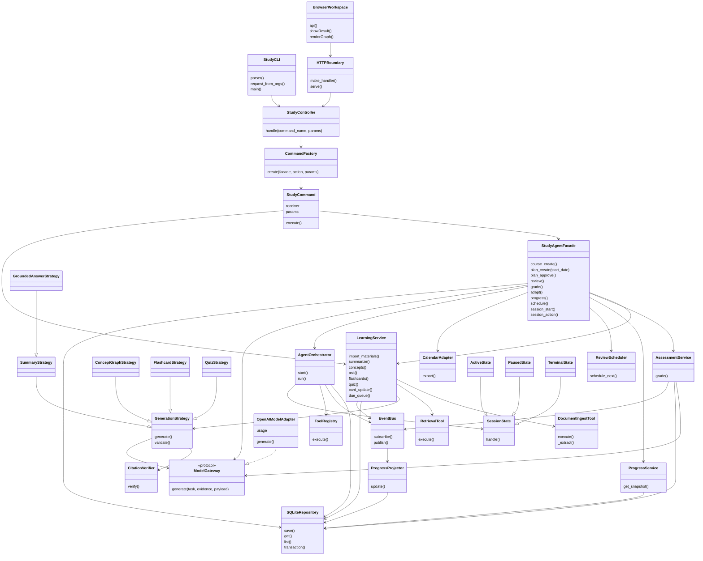
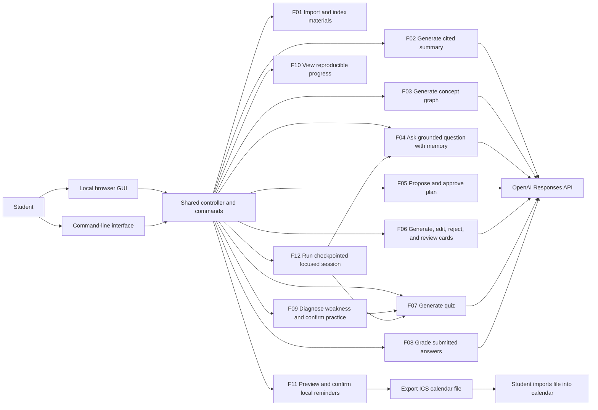

# Implemented architecture and Stage 1 change record

This document describes the source currently present, not a claim that every Stage 1 acceptance criterion or Stage 2 submission deliverable is complete. The original baseline is `StudyForge_Stage1_Project_Design_Report.pdf` (40 pages, October 9, 2026). Features retain F01-F12 IDs. No feature is silently replaced by a new feature.

The application is a local, single-user Python program. `studyforge/cli.py` and the browser workspace in `studyforge/web/`, served by `studyforge/gui.py`, call the same `StudyController.handle(command_name, **params)`. `CommandFactory.create()` constructs an executable `StudyCommand`, whose receiver is a facade or learning-service method. The HTTP server binds to loopback, checks Host/Origin and a session token, and processes one request at a time. SQLite stores course-scoped JSON aggregates and events. Generated evidence, citations, and metadata remain available for inspection.

## Updated class diagram



`StudyCLI`, `BrowserWorkspace`, and `HTTPBoundary` above are boundary labels for module functions/browser code, not Python classes. All other named classes are actual source participants. Domain records are JSON aggregates in SQLite, rather than a separate object class for every aggregate.

## Seven implemented patterns

| Pattern | Actual participants and roles | Problem solved and implementation evidence | Stage 1 relationship |
| --- | --- | --- | --- |
| MVC | Browser view (`web/`), CLI boundary, `StudyController`, application/domain services, `SQLiteRepository` model storage | Interfaces collect input and render output; controller validates course scope and dispatches use cases; shared services own rules. Changes to presentation do not duplicate grading or scheduling logic. | Retained at architectural level; `StudyDeskView` becomes a browser view, `StudyCLI` becomes module functions. |
| Command | `StudyCommand` is the command; facade/learning methods are receivers; `StudyController` is invoker; `CommandFactory` selects registered receivers | `execute()` encapsulates request parameters independently of GUI/CLI. Allowlisting prevents arbitrary attribute invocation. | Generic receiver command replaces one class per use case. The factory itself is not counted as an extra pattern. Undo/history of commands is not implemented. |
| Facade | `StudyAgentFacade` is the shared application facade | Coordinates learning, assessment, progress, plans, reminders, and sessions behind one application entry; interfaces do not call model or database directly. | Retained, with some orchestration consolidated into facade methods. |
| Strategy | `GenerationStrategy` template, `SummaryStrategy`, `GroundedAnswerStrategy`, `ConceptGraphStrategy`, `FlashcardStrategy`, `QuizStrategy` | Each strategy supplies a task, output contract, and validator while sharing evidence checks and one bounded validation retry. `LearningService._generate()` selects it. | Retained for generation. Separate adaptive strategy objects were not added; adaptation policy is in `StudyAgentFacade.adapt()`. |
| Adapter | `ModelGateway` protocol and `OpenAIModelAdapter`; `CalendarAdapter` converts reminders into iCalendar | Provider HTTP/output structure and calendar format remain outside feature policies. Tests can inject a fake model or fake HTTP opener. | OpenAI adapter retained. Remote calendar adapter replaced by local ICS exporter. |
| Observer | `EventBus` subject; `ProgressProjector.update()` observer; learning/assessment/session methods publishers | Save activity events without coupling their producers to dashboard rendering; `ProgressService.get_snapshot()` deterministically projects accepted observations. | Retained, but snapshots are computed on request from saved attempts/events rather than continuously materialized into a separate progress repository. |
| State | `SessionState` abstraction; `ActiveState`, `PausedState`, `TerminalState` concrete states; `AgentOrchestrator.run()` context | Legal pause/resume/advance/skip/stop transitions are delegated to state objects. Failure persists a recoverable pause; terminal states reject further actions. | Retained with shared active behavior for learn/practice/review; no separate class for every activity state. |

## Updated use-case model



The program does not write to a live external calendar, run a background reminder daemon, or request calendar authorization. ICS contains calendar events and a ten-minute display alarm; the receiving calendar application determines notification delivery. A student must import the exported file.

## Updated grounded-generation sequence

```mermaid
sequenceDiagram
    actor Student
    participant UI as GUI or CLI
    participant C as StudyController
    participant Cmd as StudyCommand
    participant L as LearningService
    participant R as RetrievalTool
    participant S as GenerationStrategy
    participant M as OpenAIModelAdapter
    participant V as CitationVerifier
    participant DB as SQLiteRepository
    Student->>UI: Select course and request grounded feature
    UI->>C: handle(command_name, params)
    C->>DB: get(course, course)
    C->>Cmd: execute()
    Cmd->>L: ask / summarize / concepts / flashcards / quiz
    L->>R: execute(course, query, material)
    R->>DB: list(material, course)
    R-->>L: Ranked chunks with stable locations
    alt No evidence
        L-->>UI: Evidence-gap error; no artifact saved
    else Evidence available
        L->>S: generate(evidence, payload)
        S->>M: generate(task, evidence, output contract)
        Note over M: Record reported tokens before completion/output checks
        M-->>S: Parsed JSON object
        S->>V: verify(citations, evidence)
        alt Invalid output
            S->>M: Retry once with validation feedback
            Note over S,M: Missing key and HTTP failures are not retried as schema errors
        end
        S-->>L: Validated feature result
        L->>DB: save(artifact, course, result and evidence)
        L-->>UI: Result with citations and retrieval coverage
    end
```

Citation verification establishes that references belong to retrieved course chunks. It does not prove that each claim is semantically entailed by those chunks. Coverage metadata explicitly marks outputs based on only a subset of available chunks. Q&A stores the latest turns for conversational memory; retrieval uses the current question, so ambiguous pronoun-only follow-ups can still need clarification or a more specific question.

## Updated focused-session sequence

```mermaid
sequenceDiagram
    actor Student
    participant C as StudyController
    participant F as StudyAgentFacade
    participant O as AgentOrchestrator
    participant S as SessionState
    participant T as ToolRegistry
    participant L as LearningService
    participant P as ProgressService
    participant DB as SQLiteRepository
    Student->>C: session_start(course, goal, minutes)
    C->>F: execute session-start command
    F->>O: start()
    O->>DB: Save learn state, start time, budget
    Student->>C: session_action(id, advance)
    C->>O: run(id, advance)
    O->>S: handle(session, advance)
    O->>T: explain(course, question=goal)
    T->>L: ask()
    L-->>O: Cited explanation
    O->>DB: Checkpoint result; state=practice
    Note over Student,DB: Student may pause, resume, skip, or stop at checkpoints
    Student->>C: session_action(id, advance)
    C->>O: run()
    O->>P: get_snapshot(course)
    P-->>O: Current mastery evidence
    O->>T: practice(topic, count=2, difficulty)
    T->>L: quiz()
    L-->>O: Saved quiz
    O->>DB: Checkpoint result; state=review
    Note over Student,L: Quiz submission uses the ordinary grade command
    Student->>C: session_action(id, advance)
    C->>O: run()
    O->>P: get_snapshot(course)
    O->>DB: Save review summary; state=completed
    alt Tool or model failure
        O->>DB: Save paused state and resume_state
    else Budget expired
        O->>DB: Save completed; do not run another tool
    end
```

Session planning is a bounded three-stage workflow, not an unrestricted LLM-generated tool plan. The practice checkpoint chooses the lowest measured mastery topic, if one exists, and passes difficulty to quiz generation. Review reads the current progress snapshot. The session does not automatically wait for the generated quiz to be graded, enforce every answer interaction, or repeatedly replan after each quiz item. A student may submit that quiz through the normal grading interface before advancing review.

## Remaining updated runtime interactions

These diagrams replace the affected Stage 1 sequences. Together with the grounded-generation sequence (SD02, SD04, SD07) and focused-session sequence (SD06), they account for all eleven original interaction shapes. Return values travel back through the originating GUI or CLI command boundary.

### SD01 / F01 deterministic material ingestion

```mermaid
sequenceDiagram
    participant UI as GUI or CLI
    participant C as StudyController
    participant I as DocumentIngestTool
    participant DB as SQLiteRepository
    participant E as EventBus
    participant P as ProgressProjector
    UI->>C: handle(import_materials, course, paths)
    C->>I: execute(course, paths)
    I->>DB: list(material, course)
    loop Each file independently
        I->>I: Validate file size and hash
        alt Duplicate hash
            I->>I: Add duplicate result; skip extraction
        else New material
            I->>I: _extract(path); create overlapping chunks
            Note over I: Filename metadata; no model or embedding call
            I->>DB: transaction(); save(material, course, data)
            I->>E: publish(MaterialIndexed, payload)
            E->>P: update(name, payload)
            P->>DB: save(event, course, data)
            alt Parse, save or observer failure
                I->>DB: Roll back current file transaction
                I->>I: Add per-file error; continue batch
            else Successful transaction
                I->>DB: Commit current file
            end
        end
    end
    I-->>UI: Imported, duplicate and error lists
```

Parser failure before a transaction creates no record; a save/observer failure rolls back the current transaction. Earlier successful files remain saved. Retrieval later ranks the stored chunks lexically; there is no vector index generation step.

### SD03 / F05 plan proposal and approval

```mermaid
sequenceDiagram
    participant UI as GUI or CLI
    participant F as StudyAgentFacade
    participant R as RetrievalTool
    participant P as ProgressService
    participant M as ModelGateway
    participant DB as SQLiteRepository
    UI->>F: plan_create(course, goal, deadline, daily minutes, start_date)
    F->>F: Resolve start date; validate today <= start <= deadline and minute bounds
    F->>R: execute(course, goal)
    alt Broad goal has no lexical matches
        F->>R: execute(course)
    end
    F->>P: get_snapshot(course)
    F->>M: generate(plan, evidence, goal and mastery)
    M-->>F: Ordered topic list
    F->>DB: list(graph, course)
    F->>F: Validate topics, prerequisites and capacity from start through deadline
    alt Invalid or infeasible
        F-->>UI: Error; no plan saved
    else Valid
        F->>DB: save(plan, course, draft sessions and displayed start_date)
        F-->>UI: Draft plan
        UI->>F: plan_approve(plan_id, replace)
        F->>DB: get(plan); list(plan, course)
        alt Active plan exists and replace is false
            F-->>UI: Explicit replacement confirmation required
        else Approval confirmed
            F->>DB: transaction; mark prior plan replaced; save approved plan
            F-->>UI: Approved plan
        end
    end
```

Deadline, start date and availability remain deterministic local constraints; the model receives goal, mastery and retrieved evidence. Optional `start_date` defaults to tomorrow when the deadline is in the future, otherwise today for a same-day deadline. An explicit start must be today or later and no later than the deadline. Capacity and session dates use the inclusive start-to-deadline interval. The resolved start date is persisted and displayed with the draft before approval. Missing material stops before model generation. `approve=true` on creation invokes the same approval method after the draft is saved. Approved sessions are never shifted automatically.

### SD11 / F06 flashcard review and due scheduling

```mermaid
sequenceDiagram
    participant UI as GUI or CLI
    participant F as StudyAgentFacade
    participant S as ReviewScheduler
    participant E as EventBus
    participant P as ProgressProjector
    participant DB as SQLiteRepository
    UI->>F: review(card_id, rating)
    F->>DB: list(deck)
    F->>F: Locate card and reject rejected cards
    F->>S: schedule_next(card, rating)
    S->>S: Validate integer rating 0..3; calculate interval and due date
    alt Missing card, rejected card or invalid rating
        F-->>UI: Error; no review saved
    else Valid review
        F->>DB: transaction; save(updated deck)
        F->>E: publish(CardReviewed, topic and rating)
        E->>P: update(name, payload)
        P->>DB: save(event, course, data)
        F->>DB: Commit transaction
        F-->>UI: Updated card and next due date
    end
```

`LearningService.due_queue()` subsequently reads course decks and filters rejected cards and due dates. Review scheduling and progress events do not call an LLM. Generation remains covered by SD04 through the grounded-generation sequence.

### SD05 / F08 mixed grading and auditable attempts

```mermaid
sequenceDiagram
    participant UI as GUI or CLI
    participant F as StudyAgentFacade
    participant A as AssessmentService
    participant M as ModelGateway
    participant DB as SQLiteRepository
    participant E as EventBus
    UI->>F: grade(quiz_id, answers, attempt_id)
    F->>DB: Open transaction
    F->>A: grade(quiz_id, answers, attempt_id)
    A->>DB: get(quiz); list(attempt, course)
    A->>A: Validate nonempty quiz, complete answers and unused attempt ID
    loop Every item
        alt Choice item
            A->>A: Compare normalized option text to answer key
        else Free-response item
            A->>M: generate(grade, evidence, answer and rubric)
            M-->>A: Score, feedback and confidence
            A->>A: Validate numeric bounds and feedback
        end
        A->>A: Mark confidence below 0.7 as needs_review
    end
    alt Invalid request or model grade
        A-->>UI: Error; transaction rolls back
    else Valid results
        A->>DB: save(attempt, scores, answers, rubric snapshot, evidence)
        A->>E: publish(AttemptRecorded, payload)
        E->>DB: Observer saves activity event
        F->>DB: Commit transaction
        A-->>UI: Per-item feedback, citations and total
    end
```

Low-confidence item results remain auditable in the attempt but are excluded from mastery calculations. Supplying an already-used attempt ID prevents duplicate submission; a new ID creates a separate attempt. No human-grade override interaction is implemented.

### SD09 / F09 weak-topic diagnosis and confirmed practice

```mermaid
sequenceDiagram
    participant UI as GUI or CLI
    participant F as StudyAgentFacade
    participant P as ProgressService
    participant L as LearningService
    participant DB as SQLiteRepository
    UI->>F: adapt(course, minutes, confirm)
    F->>F: Validate 5..120 minute budget
    F->>P: get_snapshot(course)
    P-->>F: Topic means and accepted observation counts
    F->>F: Select topics with count >= 2 and mastery < 0.7
    alt No eligible topic
        F-->>UI: Insufficient evidence; no diagnosis or practice generated
    else Weak topic measured
        F->>F: Select lowest mastery and introductory/intermediate difficulty
        alt confirm is false
            F-->>UI: Proposed topic, evidence count, difficulty and reason
        else confirm is true
            F->>L: quiz(course, topic, bounded count, difficulty)
            L-->>F: Saved evidence-linked quiz
            F->>DB: save(adaptation, course, recommendation and practice)
            F-->>UI: Confirmed generated practice
        end
    end
```

This is deterministic recommendation plus AI-generated practice. It does not traverse prerequisites, insert practice into an active plan, or use an AI narrative to choose the recommendation. The proposed request is recomputed against current progress when confirmed.

### SD10 / F10 reproducible progress projection

```mermaid
sequenceDiagram
    participant Producer as Assessment, review or session service
    participant E as EventBus
    participant O as ProgressProjector
    participant DB as SQLiteRepository
    participant UI as GUI or CLI
    participant P as ProgressService
    Producer->>E: publish(domain event, payload)
    E->>O: update(name, payload)
    O->>DB: save(event, course, payload)
    UI->>P: get_snapshot(course)
    P->>DB: list(attempt, course)
    P->>DB: list(event, course)
    P->>DB: list(plan, course); list(session, course)
    P->>P: Exclude low-confidence grades; aggregate scores and card ratings
    alt Sparse or empty evidence
        P-->>UI: Empty/small topic samples and actual counts
    else Accepted observations exist
        P-->>UI: Topic means, sample sizes, counts and as-of time
    end
```

There is no model call, date-range filtering, trend series or plan-adherence computation. Snapshots are computed on request rather than saved as independently materialized projections. Observer failure follows the transaction boundary of the producing use case; event history is not presented as a guarantee of every proposed Stage 1 event type.

### SD08 / F11 confirmed local reminders and ICS export

```mermaid
sequenceDiagram
    participant UI as GUI or CLI
    participant F as StudyAgentFacade
    participant DB as SQLiteRepository
    participant Cal as CalendarAdapter
    participant FS as Local filesystem
    UI->>F: schedule(plan_id, local time, timezone, confirm, export_path)
    F->>DB: get(plan); list(reminder across all courses)
    F->>F: Require approved plan; validate timezone and clock time; capture current UTC time
    loop Each plan session
        alt Stable reminder ID already exists
            F->>F: Reuse existing reminder ID, including historical records
        else New reminder
            F->>F: Calculate start/end; require new start > now; check DST, midnight and overlaps
        end
    end
    alt Invalid schedule, past new reminder or conflict
        F-->>UI: Error before reminder writes
    else confirm is false
        F-->>UI: Proposed reminders; confirmation required
    else confirm is true
        F->>DB: transaction; save stable-ID reminders; commit
        opt export_path supplied
            F->>Cal: export(saved reminders, path)
            Cal->>FS: Write UTC ICS events and ten-minute display alarms
            alt Filesystem error
                Cal-->>UI: Export error; confirmed local reminders remain saved
            else Export succeeds
                Cal-->>F: Absolute calendar file path
            end
        end
        F-->>UI: Confirmed reminders and optional file path
    end
```

This replaces the original remote-calendar authorization and write sequence. Both preview and confirmation reject a new reminder whose start is at or before the captured current time, before saving any candidate. The error asks the student to choose a later time or create and approve a future-start plan; it never silently shifts an approved plan. Existing reminder IDs remain reusable for idempotent retries and historical inspection. Calendar access, remote conflict inspection, delivery of notifications, and importing the file are outside this application. Importing an ICS file repeatedly is governed by the receiving calendar's behavior.

## Consolidated feature and class change record

| Original design | Actual implementation | Reason | Impact and remaining limits |
| --- | --- | --- | --- |
| F01 hybrid AI titles/tags, local vector embeddings; `DocumentIngestTool`, named material repository | TXT/MD/PDF/DOCX parsing, SHA256 duplicates, overlapping chunks, filename titles/tags, lexical retrieval; `DocumentIngestTool`, `RetrievalTool`, generic repository | Avoid an embedding service dependency and make import deterministic and locally inspectable | AI metadata inference and vector embeddings are not implemented. Scanned PDFs need OCR outside the application. PDF/DOCX formatting is reduced to text. Per-file save plus event is transactional. |
| F02 selected-section summaries, concise/detailed content, evidence checking | `SummaryStrategy`, material selection, detail and optional focus at service level; persisted retrieved evidence and partial-coverage metadata | Bounded prompts and common validation pipeline | No section-selector domain object or exhaustive whole-course summarization; GUI/CLI option exposure may be narrower than service arguments. Citations validate references, not semantic truth. |
| F03 confidence-bearing knowledge map, quarantine unsupported edges | `ConceptGraphStrategy` normalizes duplicate names, checks confidence/endpoints/relation types, rejects invalid generated graph and retries | Keep the graph internally consistent and preserve evidence | Invalid relations are rejected rather than placed in a quarantine workflow. Regeneration saves another graph record; there is no graph-version comparison service. Browser renders graph nodes/edges and evidence data; no dedicated graph-editing domain service. |
| F04 `IntentRouter`, `TaskPlanner`, grounded strategy and conversation repository | Explicit feature command, ranked lexical retrieval, `GroundedAnswerStrategy`, last four stored turns, shared SQLite store | Predictable, testable course-scoped execution without a second model routing request | No model intent classifier, query decomposition, or autonomous retrieval-plan search. Empty retrieval is an explicit gap; ambiguous contextual questions may fail lexical retrieval. |
| F05 learner profile, priorities, availability windows, prerequisite plan validator, approval | `StudyAgentFacade.plan_create()` obtains ordered topics from model using goal retrieval or course-wide fallback for broad goals, resolves and persists optional start date (tomorrow by default for future deadlines), validates capacity over start through deadline and known graph ordering, builds dated slots; `plan_approve()` requires replacement confirmation | Feasible minimum local planner with explicit dates, approval and deterministic safeguards; tomorrow defaults avoid proposing already elapsed same-day slots | No learner-profile class, arbitrary availability windows, priority weights, detailed activity/checkpoint generation, or automatic alternative proposal. Known graph constraints apply when matching topics exist. |
| F06 generated cards, duplicate filters, review scheduler, edit/reject | `FlashcardStrategy`, `ReviewScheduler`, `LearningService.card_update()` and `due_queue()`, `review()` with 0-3 ratings | Retain source-linked practice and a deterministic, understandable interval rule | Scheduler is a simple rating-based interval policy, not a calibrated learning algorithm. User edits are marked `user_edited`; their semantics are not reverified by an LLM. Rejected cards cannot be reviewed. |
| F07 objective/free-response quiz, objectives/format/difficulty/coverage validation, partial quiz fallback | `QuizStrategy` validates requested count, uniqueness, choice options/key, free rubric, topic, difficulty and citations | Prevent malformed quizzes and persist full evidence | Explicit objective-coverage validation, user-selected format mix, partial-quiz fallback and a separate `QuizValidator` are absent. Invalid count or repeated invalid output fails safely. |
| F08 attempts, deterministic objective grading, rubric LLM grading, confidence review | `AssessmentService.grade()` validates complete answers, exact normalized objective key, free-response score/feedback/confidence, stores rubric snapshot, excludes low-confidence grades from mastery | Preserve auditable scoring with a deterministic objective path | Low-confidence results are flagged, but no human-grade override workflow is implemented. Duplicate protection depends on reusing attempt ID; a new ID is a separate attempt. There is no independent `Attempt` domain class. |
| F09 prerequisite-aware strategy selection, AI explanation, confirmation before plan insertion | `StudyAgentFacade.adapt()` requires two observations, identifies lowest weak topic, sets difficulty, confirms before generating quiz | Avoid confident diagnosis from a single result and reuse verified quiz generation | Recommendation explanation is deterministic, not AI narrative. No prerequisite-remediation traversal, separate `AdaptationService`/strategy, or active-plan insertion. Confirmed practice is saved as quiz plus adaptation record. |
| F10 analytics projections, mastery, adherence, date ranges, trends and optional narrative | `ProgressProjector` stores activity events; `ProgressService` computes accepted item/card means, sample sizes, attempt count, completed sessions and event count | Reproducible small local analytics without invented measurements | Plan adherence, date filtering, trend series/charts and AI narrative are not implemented. Metrics are descriptive sample averages, not validated mastery estimates. |
| F11 remote calendar authorization/writes, rescheduling, retryable pending records | `schedule()` previews/approves reminders, validates timezone/overlaps across courses and rejects new starts at or before now, preserves approved plan dates, uses stable session-based IDs, optionally calls `CalendarAdapter.export()` | Deliver useful scheduling without third-party credentials, external writes or silent date shifts; keep historical reminder retries idempotent | Local ICS replacement; manual import required. No live calendar conflict read, background notifications, AI rescheduling, remote retries or authorization. Export filesystem failure leaves confirmed local reminders available for retry. |
| F12 arbitrary typed plan, Setup/Learn/Practice/Review, retries and adaptation after activities | `AgentOrchestrator`, `ToolRegistry`, three-stage workflow, actual learning tool calls, persisted checkpoints, `SessionState` objects, legal controls and wall-clock budget | Bound scope and make recovery observable and testable | No separate Setup state, arbitrary activity mix, per-answer continuous replanning or autonomous scheduling. Paused time counts toward wall-clock budget. See session sequence above. |
| Separate classes/repositories for Course, Material, Plan, Quiz, Attempt, Session and snapshots | JSON aggregate records and one `SQLiteRepository` with kind/course indexing and transactions | Reduce unused indirection and keep storage behavior consistent | Aggregate invariants live in service validators rather than domain model constructors. Report and diagrams reflect actual classes. |
| Many concrete `ImportMaterialCommand`, `GradeAttemptCommand`, etc. | One receiver-based `StudyCommand`, registered `CommandFactory` | Every use case already has a cohesive method; avoids empty wrappers | Command names remain explicit; no named per-feature command classes or undo implementation. |
| `IntentRouter`, `TaskPlanner`, `PlanValidator`, `ConceptGraphService`, `AdaptationService`, named strategy for every operation | Command allowlist; facade policies; generation strategy validators; `AgentOrchestrator` | Consolidate rules around actual operations rather than create unused diagram classes | The original class names and some broader behavioral promises are intentionally not claimed. |
| Provider adapter and reproducible operation accounting | `OpenAIModelAdapter.generate()` places an explicit JSON output instruction in the serialized input envelope and accumulates provider-reported input/output tokens immediately after parsing the response envelope, before completion or generated-output validation; only nonnegative integer counts are accepted | Satisfy the provider JSON-mode input requirement and retain billed usage even when output is incomplete, malformed or rejected | Missing or invalid usage fields are not fabricated. Counts are in-memory API-reported tokens, not a measured money bill; HTTP error bodies do not supply token totals. |
| Performance cache keyed by provider/schema/content versions | No generation cache | Avoid stale artifact reuse before cache invalidation requirements are settled | Repeated generation incurs model calls and cost; only saved artifacts are reusable manually. |

Course creation, record inspection, due-card browsing, and card editing are supporting operations for the original feature set; they are not counted as additional meaningful features to hide omissions. All twelve original features have a working path in source, with the reductions above. The final live sample run passed 23 checks across F01-F12; see `live-verification.json`. This sample acceptance does not guarantee arbitrary model behavior. Video evidence, owner review, measured cost accounting and final submission remain separate requirements.
